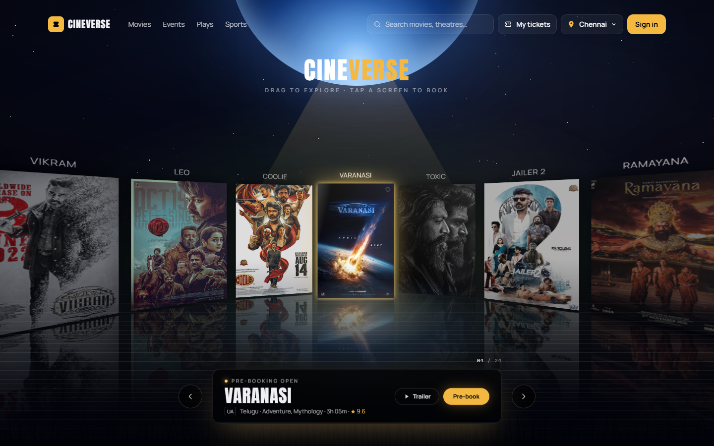
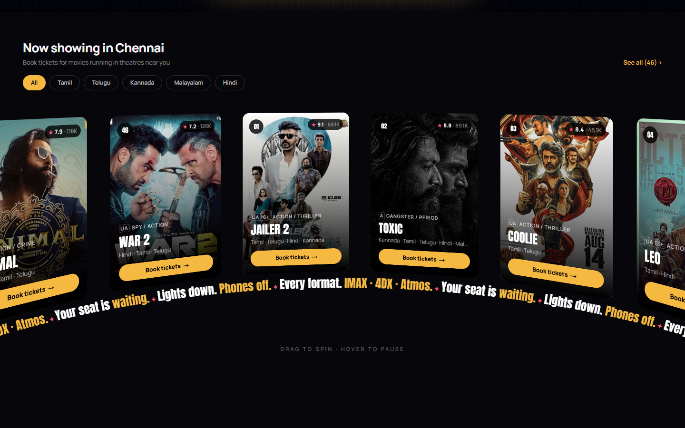
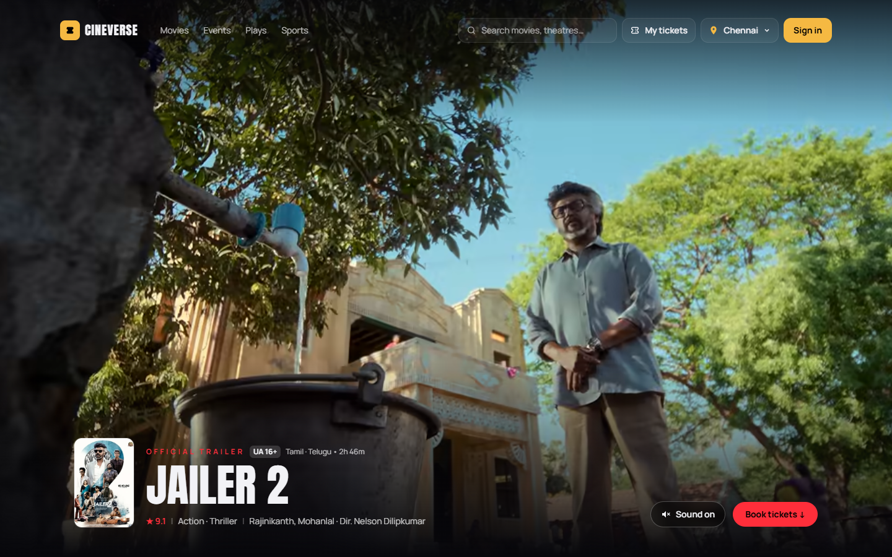
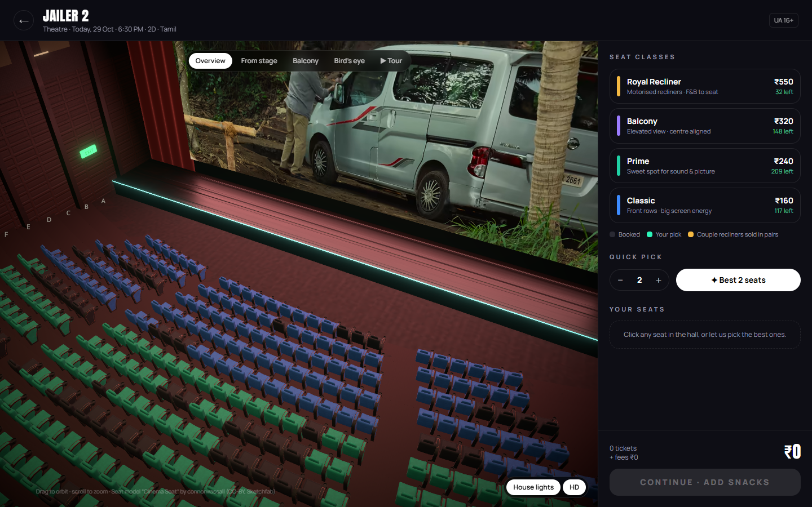
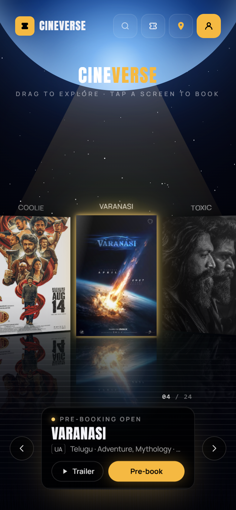

<div align="center">

# 🎬 CINEVERSE

### A next-generation movie ticket booking experience

**[▶ Try the live demo → cineverse-blond-nine.vercel.app](https://cineverse-blond-nine.vercel.app)**



</div>

---

## ✨ Highlights

- **3D panorama hero:** a curved ring of cinema screens you can drag, swipe and tap to book
- **3D cinema hall seat picker:** pick seats inside a real-time 3D theatre, preview the screen view from any seat, plus camera presets (Overview, From stage, Balcony, Bird's eye) and an auto tour
- **Trailer-first movie pages:** a full-screen trailer, a theatre board with smart picks, and timeline showtimes
- **Complete booking flow:** seats → snacks → review → pay → QR ticket, with tickets saved under *My tickets*
- **Built for mobile:** tested on phones (iPhone Safari & Android)

## 📸 Screenshots

| Now showing | Movie page |
|---|---|
|  |  |

| 3D seat selection | Mobile |
|---|---|
|  |  |

## 🛠 Built with

Next.js · React · TypeScript · Three.js / React Three Fiber · GSAP · Motion · Lenis · Tailwind CSS · Zustand · Vercel

## 🧠 How it works (pseudo-code)

> Simplified pseudo-code that shows the ideas. It is not the real source.

### 1. Best seats finder ("✦ Best 2 seats")

```text
function BEST_SEATS(quantity, soldSeats, category):
    best = none
    for each row in hall:
        if category is chosen and row.category ≠ category: skip
        for each window of `quantity` side-by-side seats in row:
            if any seat is sold                → skip
            if seats cross an aisle            → skip
            if it splits a couple recliner     → skip
            score = distanceFromCentre(window) * 1.2
                  + distanceFromSweetSpotRow(row)   // balcony weighted lower
            if score < best.score: best = window
    return best
```

### 2. 3D hall camera that never goes through walls

```text
every frame:
    target = user drag / preset / seat view
    position = clamp(position,
                     inside walls  - margin,
                     below ceiling - margin,
                     above seats + balcony slab)
    move camera along a STRAIGHT line to target   // curved paths cut through walls
    if screen is far off-axis or blocked:
        fade out the trailer video                 // keeps it fast and clean
```

### 3. Panorama hero (ring of screens)

```text
screens = featured movies placed around a circle
every frame:
    angle  += drag velocity (with friction)
    snap angle to the nearest screen when released
    every 5.2 s → rotate to the next screen (progress bar)
    front screen: scale up + glow;  side screens: darker by angle
    sky colour  = blurred colour of the front poster
    on click(side screen) → rotate it to the front
    on click(front screen) → open the movie page
```

### 4. Showtimes (demo data)

```text
function GET_SHOWS(movie, city, day):
    seed = hash(movie + city + day)        // same input → same result
    for each theatre in city:
        pick formats (2D / IMAX / 4DX) and times using seeded random
        mark seats filling up by time of day
    return theatres sorted by distance
```

### 5. Booking flow

```text
Movie → Theatre & time → 3D seat pick → Snacks → Review → Pay
      → generate ticket ID + QR code → save to "My tickets"
```

## 💬 Build prompts

This project was designed and built with an AI coding assistant (Claude Code).
These are some of the prompts that shaped it:

```text
"Build a premium movie ticket booking website like BookMyShow / District,
 with dummy data for Tamil, Telugu, Kannada, Malayalam and Hindi movies."

"Make the seat selection a real 3D cinema hall. Let me see the screen
 from my seat, add camera views: overview, from stage, balcony, bird's eye."

"The camera goes through the walls when I drag. Fix it so it always stays
 inside the hall."

"Home page hero: a curved ring of cinema screens I can drag and tap to book."

"Open the movie page with the trailer playing full screen, then scroll to details."

"Add a snacks step with real food photos and a live cart."

"It must work on iPhone Safari and stay fast. Compress images, remove heavy effects."
```

## 🔒 Source code

This repository is a **showcase only**. The source code is private.
All movie data shown in the demo is dummy data for demonstration purposes.
Movie posters and trailers belong to their respective owners.
3D seat model: "Cinema Seat" by connorwassall (CC-BY, Sketchfab).

© 2026 Karthik Akash. All rights reserved.
